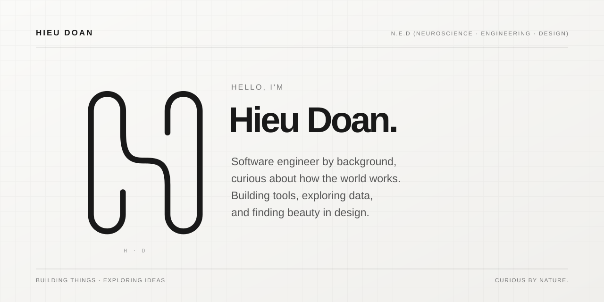

# 👨‍💻 I'm [Hieu Doan][hieudoanm]

I'm a **software engineer** by background, fascinated by the intersection of **technology, science, and creativity**. That curiosity has led me to pursue an MSc in Cognitive Neuroimaging and Data Science (Computational Neuroscience) at the University of Birmingham, where I'm exploring how **data and computational methods** can help us better understand the **human brain**.

Beyond academia, I enjoy **building tools** that make everyday life a little better. I'm particularly interested in **data science and machine learning with Rust**, exploring how to turn computational ideas into practical, well-engineered software. My interest in **graphic design and vector art** brings another dimension to this process: finding simple, thoughtful ways to turn ideas into something tangible.

Find me at [Resume][resume] · [LinkedIn][linkedin] · [Twitter][twitter] · [Instagram][instagram].

<!-- Profile -->

[hieudoanm]: https://hieudoanm.github.io
[resume]: https://github.com/hieudoanm/hieudoanm.github.io/blob/master/RESUME.md
[linkedin]: https://www.linkedin.com/in/hieudoanm/
[twitter]: https://x.com/hieudoanm
[instagram]: https://instagram.com/hieudoanm.github.io

## Build with Rust

1. ♟️ [Chess][chess] · [Repository][chess.repo] — A UCI-compatible chess engine in Rust — alpha-beta search, incremental NNUE evaluation, and an MCP server for AI agents
2. 📄 [Grobid][grobid.rs] · [Repository][grobid.rs.repo] — Convert PDF articles to Markdown via GROBID TEI XML — making PDFs AI-friendly on your own machine
3. 🌐 [Linguae][linguae] · [Repository][linguae.repo] — Detect the language of text with a local character-level model — no cloud, no pretrained weights, no network calls
4. 🤖 [Local Learning Machine][llm.rs] · [Repository][llm.rs.repo] — Train supervised, semi-supervised, unsupervised, and offline reinforcement-learning models from CSV files and export them as portable ONNX models
5. 🧠 [Neuroimaging Lab][neuro.lab] · [Repository][neuro.lab.repo] — Local-first desktop workspace for EEG, MEG, and MRI research data — Tauri + React frontend over Rust crates
6. 🔍 [Tracers][tracers] · [Repository][tracers.repo] — A high-performance, multi-language code intelligence and graph analysis tool
7. 🎙️ [Transcribers][transcribers] · [Repository][transcribers.repo] — Extract transcripts from video and audio files locally with ffmpeg and whisper.cpp

[chess]: https://hieudoanm.github.io/chess/
[grobid.rs]: https://hieudoanm.github.io/grobid.rs/
[linguae]: https://hieudoanm.github.io/linguae/
[llm.rs]: https://hieudoanm.github.io/llm.rs/
[neuro.lab]: https://hieudoanm.github.io/neuro.lab/
[tracers]: https://hieudoanm.github.io/tracers/
[transcribers]: https://hieudoanm.github.io/transcribers/

[chess.repo]: https://github.com/hieudoanm/chess
[grobid.rs.repo]: https://github.com/hieudoanm/grobid.rs
[linguae.repo]: https://github.com/hieudoanm/linguae
[llm.rs.repo]: https://github.com/hieudoanm/llm.rs
[tracers.repo]: https://github.com/hieudoanm/tracers
[transcribers.repo]: https://github.com/hieudoanm/transcribers
[neuro.lab.repo]: https://github.com/hieudoanm/neuro.lab

## Design Projects

1. 🎨 [Design (System) Design][design.system.design] · [Repository][design.system.design.repo] — A design system monorepo for building consistent, accessible UI components and documentation
2. 🍜 [Food & Drink][fdr] · [Repository][fdr.repo] — A small, fast food-picker app: spin a country wheel or dish reel, browse menus, or follow Sheldon's weekly schedule
3. ⌚ [Forerunner 55][fr55] · [Repository][fr55.repo] — Connect IQ Watchfaces and tooling for the Garmin Forerunner 55, including a Monkey C VS Code extension and VSIX
4. 🏦 [NEO Bank][neo.bank] · [Repository][neo.bank.repo] — A full-stack banking demo: Go microservices, Cassandra, Kafka sagas, and a React frontend — with a static landing page on GitHub Pages
5. 🖼️ [Vectors][vectors] · [Repository][vectors.repo] — Turn PNG and JPEG images into clean SVG paths — and rasterize SVG back to PNG at any size — entirely offline

[design.system.design]: https://hieudoanm.github.io/design.system.design/
[fdr]: https://hieudoanm.github.io/fdr/
[fr55]: https://hieudoanm.github.io/fr55/
[vectors]: https://hieudoanm.github.io/vectors/
[neo.bank]: https://hieudoanm.github.io/neo.bank/

[design.system.design.repo]: https://github.com/hieudoanm/design.system.design/
[fdr.repo]: https://github.com/hieudoanm/fdr/
[fr55.repo]: https://github.com/hieudoanm/fr55/
[vectors.repo]: https://github.com/hieudoanm/vectors/
[neo.bank.repo]: https://github.com/hieudoanm/neo.bank/
